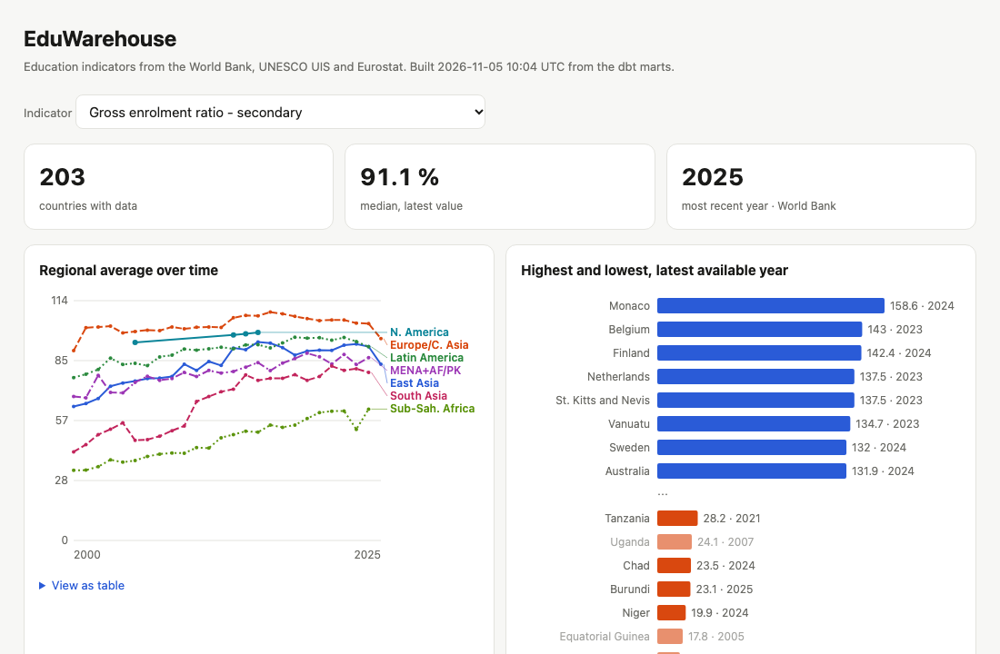

# EduWarehouse

[](https://github.com/BlessingSK1998/eduwarehouse/actions/workflows/refresh.yml)

### [Open the live dashboard →](https://blessingsk1998.github.io/eduwarehouse/)

[](https://blessingsk1998.github.io/eduwarehouse/)

An automated education-indicators pipeline. It pulls from three public APIs, lands the raw data in DuckDB, models it with dbt, tests it, and rebuilds a dashboard every week via GitHub Actions.

```
World Bank API ─┐                                   ┌─ staging (views, typed + cleaned)
UNESCO UIS API ─┼─ extract.py ─► data/raw/*.jsonl ─►│  raw.* ─► marts (dim_ / fct_ / mart_)
Eurostat API  ──┘   (retries)      load.py (DuckDB)  └─ 32 data tests + freshness ─► dashboard/index.html
```

## Run it

```bash
make setup      # venv, dependencies, dbt packages
make all        # extract -> load -> dbt build -> dashboard   (~20 s, no API keys needed)
open dashboard/index.html
```

Individual steps: `make extract`, `make load`, `make build` (dbt), `make dashboard`, `make test` (pytest).

## What's in it

| Layer | Files | Notes |
|---|---|---|
| Extract | `pipeline/extract.py` | Pure parsers + thin HTTP wrappers with exponential backoff. Fails loudly if a source returns 0 rows. Writes JSONL to `data/raw/`. |
| Load | `pipeline/load.py` | Full-refresh `CREATE OR REPLACE` into the `raw` schema with explicit column types, so reruns are idempotent. |
| Transform | `dbt/models/` | `staging` (views) → `marts`: `dim_country`, `dim_indicator`, `fct_indicator_observation` (indicator × country × year), `mart_country_latest`, `mart_region_trends`, `mart_source_reconciliation`, `mart_data_coverage`. |
| Tests | `dbt/models/**/schema.yml`, `dbt/tests/`, `tests/` | 32 dbt data tests plus source freshness, and 6 offline pytest unit tests for the parsers. |
| Orchestration | `.github/workflows/refresh.yml` | Mondays 05:00 UTC, manual dispatch, and on PRs. Runs pytest, the pipeline, `dbt build`, `dbt source freshness`, then deploys the dashboard to GitHub Pages. |

**Indicators (12):** adult literacy, primary net / secondary and tertiary gross enrolment, government spend on education (% GDP), primary completion (World Bank and UIS), lower- and upper-secondary completion, out-of-school rate (UIS), tertiary attainment 25–34 and early school leavers (Eurostat). The list lives in `pipeline/config.py` and `dbt/seeds/indicator_catalog.csv`. To add one, add it to both.

## Data-quality tests

- **Structural:** `not_null`, `unique`, `relationships`, `accepted_values`, and `unique_combination_of_columns` at every grain.
- **Plausibility:** `assert_values_within_catalog_bounds` fails if any value is negative or above the indicator's `max_plausible_value`.
- **Source health:** `assert_all_sources_present` (a whole API going silent), `assert_eurostat_geos_mapped` (new country codes), `assert_no_future_years`, source freshness (warn at 8 days, error at 15).
- **Cross-source:** `assert_sources_agree_on_primary_completion` is a `warn`, deliberately.

## Findings worth knowing

- **The plausibility test caught a real mistake of mine.** I first used UIS `OFST.1.CP` as an out-of-school *rate*. It is a head count (values up to 127 million), and the bounds test failed with 3,167 rows. The rate is `ROFST.1.CP`.
- **The World Bank API pads some region names with trailing spaces** (`'Sub-Saharan Africa '`), which silently splits a region into two groups. Found while building the dashboard labels; now trimmed in `stg_countries` and guarded by `assert_dim_country_text_is_trimmed`.
- **World Bank and UIS disagree on primary completion.** Where both report the same country-year (852 pairs) the median gap is 3.7 points, and 39% differ by more than 5. They define "completion" differently, so it is surfaced as a warning and shown on the dashboard rather than hidden.
- **Eurostat only covers ~36 European countries**, so its regional trends have one region. Coverage is on the dashboard.
- Regional averages are simple unweighted means (not population-weighted), and a country's "latest" value can be from different years across countries.

## Not verified

- The GitHub Actions workflow has been syntax-checked locally but **has not run on GitHub yet**. It must live at the root of a repository to execute; if this folder stays inside a larger repo, move `.github/` to the repo root and prefix the paths with `analysis/eduwarehouse/`. For Pages deploys, enable Settings → Pages → Source: GitHub Actions.
- Everything else (extract, load, dbt build, dashboard) was run end to end against the live APIs on 2026-11-05.

## Design choices

- **DuckDB over PostgreSQL:** zero infrastructure, so CI and reviewers can run it with one command. dbt is the only coupling to the engine; switching to Postgres means swapping `dbt-duckdb` for `dbt-postgres`, changing `profiles.yml`, and rewriting `QUALIFY` (used in `mart_country_latest`) and `read_json` in `load.py`.
- **Full refresh over incremental:** the whole dataset is ~55k rows and loads in about a second, so incremental logic would add risk without benefit.
